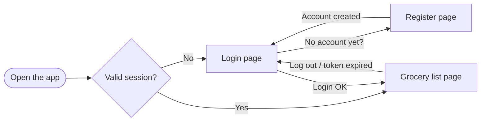
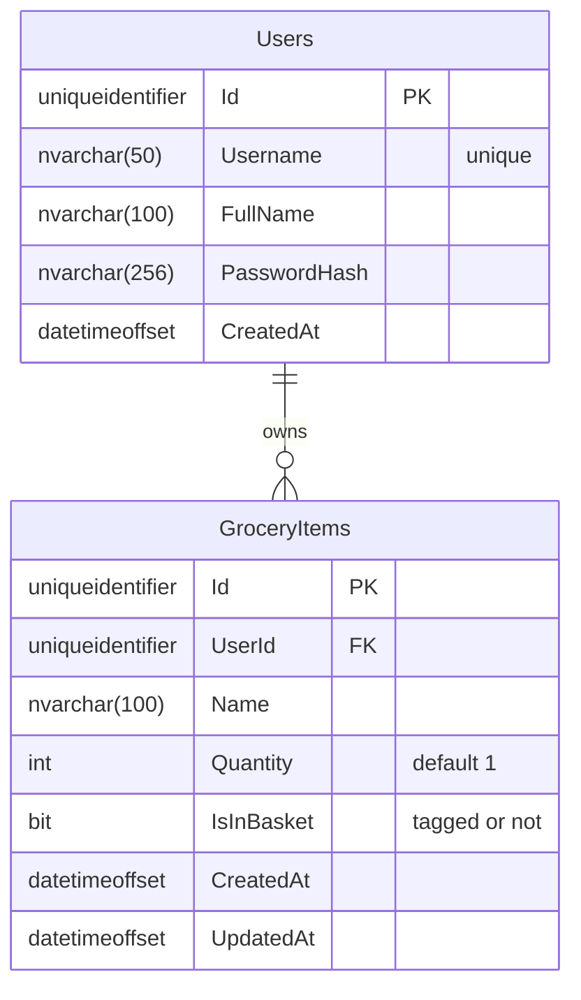
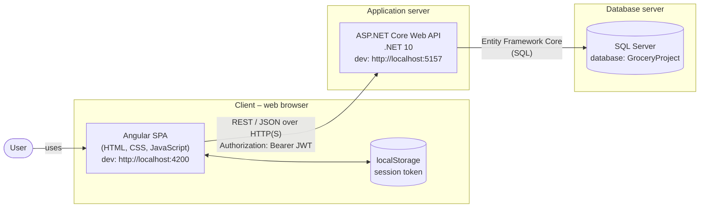
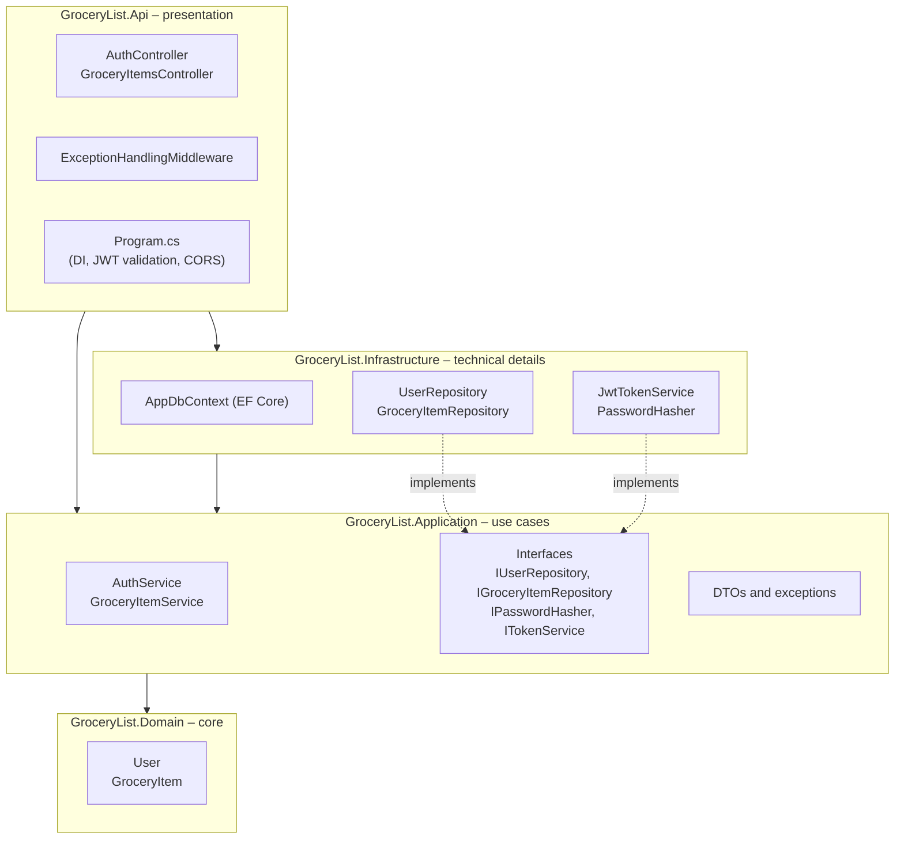
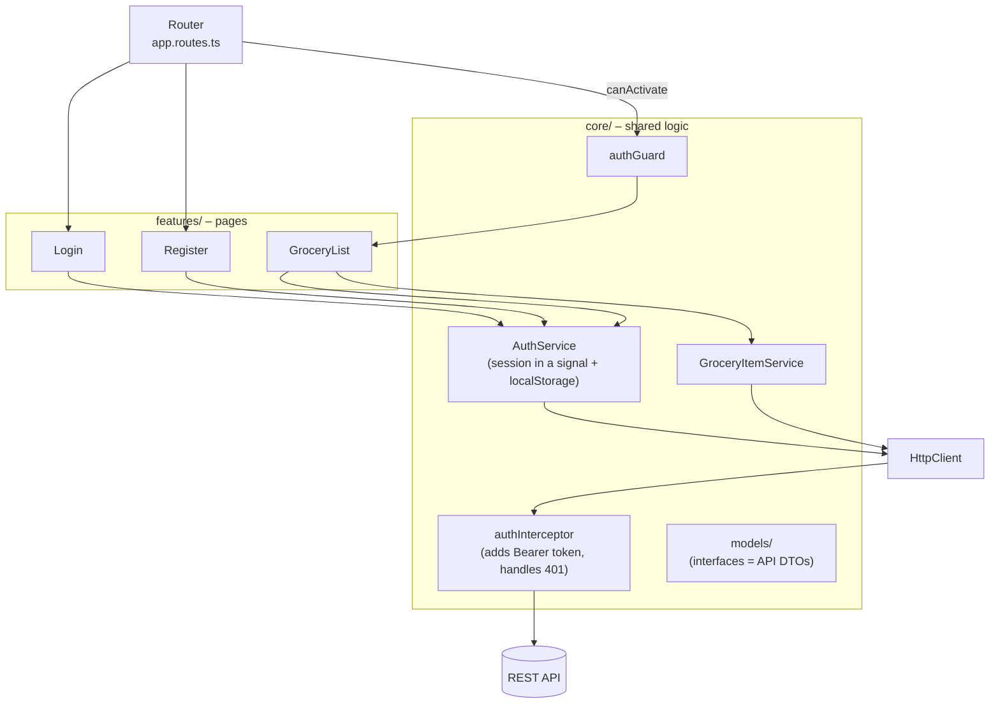
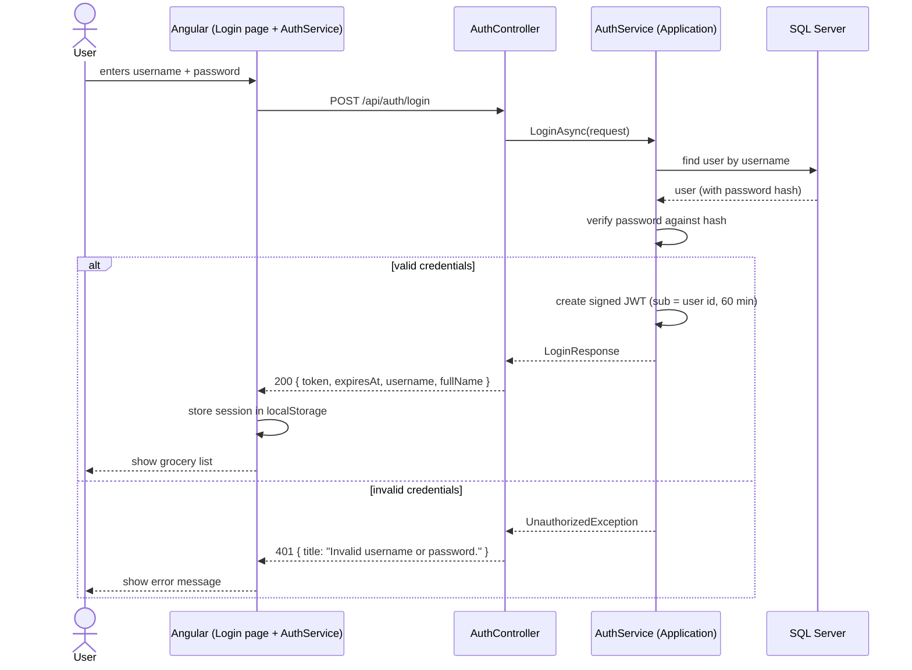
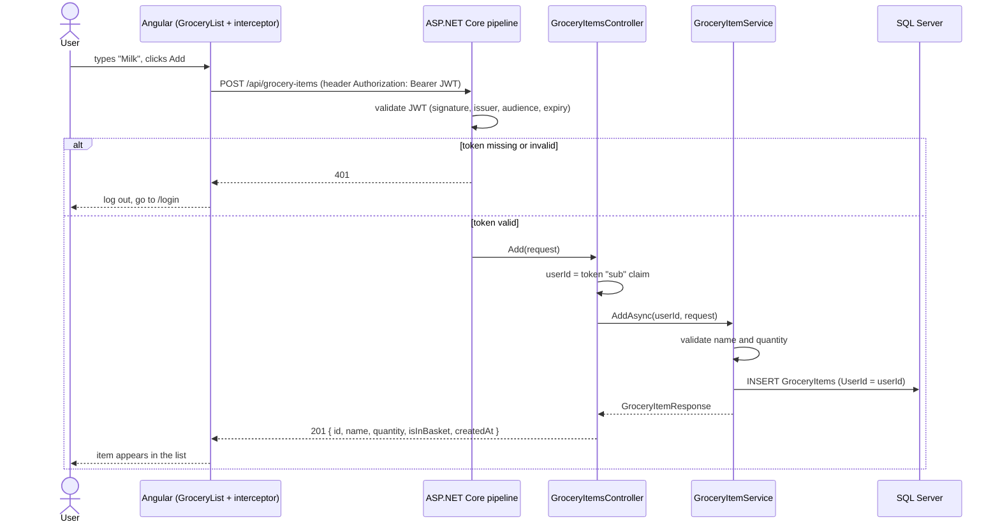

# Architecture

This document explains the design of the Grocery List app in three views:

1. [Functional design](#1-functional-design) – *what* the app does
2. [Logical design](#2-logical-design) – the concepts, data and rules
3. [Technical design](#3-technical-design) – *how* it is built: system and software architecture, technology choices

All diagrams are written in [Mermaid](https://mermaid.js.org/), so they render directly on GitHub
and can be edited as plain text.

---

## 1. Functional design

### Actors

There is one actor: the **user**. A visitor without a session can only register or log in.

### User stories and how they are covered

| # | User story | Page (frontend) | Endpoint (backend) |
|---|---|---|---|
| 1 | Register with username, full name and password | `/register` | `POST /api/auth/register` |
| 2 | Log in with username and password | `/login` | `POST /api/auth/login` |
| 3 | See my grocery list (not the products of other users) | `/groceries` | `GET /api/grocery-items` |
| 4 | Add a product | `/groceries` – add form | `POST /api/grocery-items` |
| 5 | Remove a product | `/groceries` – "Remove" button | `DELETE /api/grocery-items/{id}` |
| 6 | Tag a product (put it in the basket) | `/groceries` – tick the checkbox | `PATCH /api/grocery-items/{id}/basket` `{ "isInBasket": true }` |
| 7 | Un-tag a product (put it back) | `/groceries` – untick the checkbox | `PATCH /api/grocery-items/{id}/basket` `{ "isInBasket": false }` |
| 8 | Log out | `/groceries` – "Log out" button | none – the client deletes its token |
| 9 | No session → no products | `authGuard` redirects to `/login` | every grocery endpoint returns `401` without a valid token |

### Screen flow



---

## 2. Logical design

### Domain model

There are two concepts:

- **User** – a person with a unique username, a full name and a (hashed) password.
- **GroceryItem** – a product on a user's list, with a name, a quantity and a flag `IsInBasket`.
  *Tagging* a product means `IsInBasket = true`; *un-tagging* means `IsInBasket = false`.



The schema is created by [`database/create-tables.sql`](../database/create-tables.sql).
Deleting a user deletes their items (`ON DELETE CASCADE`).

### Business rules

| Rule | Where it is enforced |
|---|---|
| A username can only be registered once | `AuthService` (409 Conflict) and a unique index in the database |
| Username 1–50 chars, full name 1–100 chars, password at least 6 chars | `AuthService` (and the register form, for quick feedback) |
| Product name 1–100 chars, quantity at least 1 | `GroceryItemService` (and the add form) |
| A user can only see and change **their own** items | Every repository query filters by `UserId`, and the `UserId` always comes from the token |
| An item of another user is reported as "not found" (404), not "forbidden" | `GroceryItemService` – this does not reveal that the item exists |
| Login errors never say whether the username or the password was wrong | `AuthService` – prevents guessing which usernames exist |

### Authentication model

Authentication uses **JSON Web Tokens (JWT)** and is **stateless**: the server stores no sessions.

1. On login the API checks the password and returns a signed token (valid for 60 minutes).
2. The frontend stores the token and sends it with each request: `Authorization: Bearer <token>`.
3. The API checks the signature, issuer, audience and expiration of the token, and reads the user id
   from its `sub` claim.
4. Logging out means the frontend forgets the token.

---

## 3. Technical design

### 3.1 System architecture

How the parts are deployed and how they communicate.



- The **frontend** is a Single Page Application: the browser downloads it once and then only exchanges
  JSON with the API. It holds no business data of its own.
- The **backend** is the only part that talks to the database. It owns validation, security and data access.
- **CORS** in the API allows only the configured frontend origins (`Cors:AllowedOrigins`) to call it from a browser.
- Each part can be deployed, scaled and replaced independently. The only contract between them is the
  [REST API](api.md).

### 3.2 Software architecture – backend (Clean Architecture)

The backend is split into four projects (layers). **Dependencies always point inwards**: the inner
layers do not know anything about the outer ones.



| Layer | Responsibility | Depends on |
|---|---|---|
| **Domain** | The business entities (`User`, `GroceryItem`) | nothing |
| **Application** | Use cases (register, login, list/add/remove/tag items), validation, DTOs, and the **interfaces** it needs | Domain |
| **Infrastructure** | Implementations of those interfaces: SQL Server through EF Core, JWT creation, password hashing | Application |
| **Api** | HTTP: controllers, error handling, authentication setup. Connects interfaces to implementations (dependency injection) | Application, Infrastructure |

**Why this matters (Dependency Inversion):** the Application layer says *"I need something that stores
grocery items"* (`IGroceryItemRepository`), and Infrastructure provides it. To move to another database,
only Infrastructure changes. Business rules stay untouched.

#### Request lifecycle (backend)

```
HTTP request
  → ExceptionHandlingMiddleware   (turns exceptions into 400/401/404/409/500 JSON)
  → CORS                          (only allowed origins)
  → Authentication                (validates the JWT, builds the user identity)
  → Authorization                 ([Authorize] → 401 if there is no valid token)
  → Controller                    (reads the user id from the token, calls the service)
  → Service (Application)         (validates and applies business rules)
  → Repository (Infrastructure)   (EF Core query, always filtered by UserId)
  → SQL Server
```

### 3.3 Software architecture – frontend (Angular)



- **Standalone components** (no NgModules) and **signals** for state. This is the current Angular style.
- **Services** are the only place that knows the API URLs. Pages call services, never `HttpClient` directly.
- The **interceptor** adds the token to every request, so services do not deal with authentication.
- The **guard** keeps users without a session away from `/groceries`. This is for user experience only:
  the real protection is the API returning `401`.

### 3.4 Main flows

#### Login



#### Add a product (authenticated request)



### 3.5 Technology choices

| Choice | Why |
|---|---|
| **Angular + TypeScript** | Full framework with routing, forms and HTTP built in. TypeScript catches errors at compile time and keeps the frontend models in sync with the API DTOs |
| **SCSS** | Variables and nesting keep the styles short and consistent. Colors are defined once |
| **ASP.NET Core Web API (.NET 10, C#)** | Current long-term support version. Built-in dependency injection, JWT authentication and middleware pipeline |
| **Clean Architecture** | Clear separation of business rules and technical details. Easy to find code, test it and replace parts (for example the database) |
| **Entity Framework Core** | Typed LINQ queries instead of SQL strings (no SQL injection). Maps tables to C# classes |
| **Plain SQL script instead of EF migrations** | The schema is visible and reviewable in one file. Anyone can create the database with a single command. EF Core is only used to read and write data |
| **SQL Server (LocalDB)** | Relational data with a clear relation (user → items). LocalDB needs no server installation for development |
| **JWT (stateless)** | No session storage on the server. Any client (web, mobile) can use the same API by sending the token |
| **ASP.NET Core Identity `PasswordHasher`** | Proven PBKDF2 hashing with a random salt. We only use the hasher, not the whole Identity system, to keep things simple |
| **ProblemDetails for errors** | Standard JSON error format (RFC 7807) that any client can read |

### 3.6 Security summary

| Concern | Measure |
|---|---|
| Password storage | Only a salted PBKDF2 hash is stored, never the password |
| Authentication | Signed JWT with issuer, audience, signature and lifetime validated on every request |
| Data isolation between users | User id comes **only** from the token, and every query filters by it |
| Hiding information | Same error for unknown user and wrong password. Other users' items return 404. Unexpected errors return a generic 500 message |
| Browser access | CORS allows only the configured frontend origins |
| SQL injection | EF Core always uses parameterized queries |

Known limitations (secrets in config, token in localStorage, no HTTPS in local development…) are listed
in [handover.md](handover.md#known-limitations).
